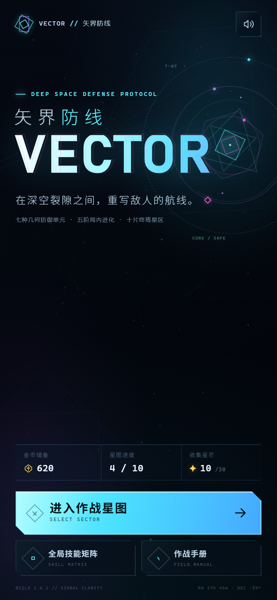
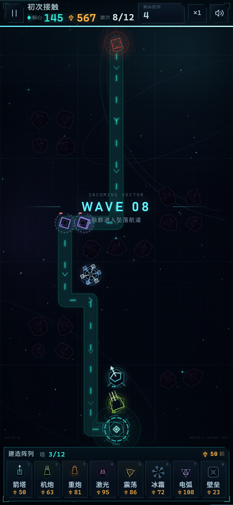

# VECTOR // 矢界防线

一款可直接在浏览器运行的竖版深空塔防游戏。画面采用 2D 几何空心图形与霓虹线条风格，所有图形、图标、塔、敌人、特效和星空背景均由 Canvas / CSS 程序化绘制，没有外部图片、字体或音频素材。




## 运行

直接双击 `index.html` 即可游玩（经典脚本加载，不依赖构建工具）。

也可以在项目目录启动一个本地静态服务器：

```powershell
python -m http.server 5180 --bind 127.0.0.1
```

然后打开 <http://127.0.0.1:5180/>。

## 静态部署包

已生成并验证可直接上传的静态部署产物：

- `dist/`：部署目录，包含 `index.html`、`styles.css`、`src/` 与部署说明；
- [`release/vector-td-v1.6.2-static.zip`](release/vector-td-v1.6.2-static.zip)：压缩包，解压后即可作为静态站点内容；
- [`release/vector-td-v1.6.2-static.zip.sha256`](release/vector-td-v1.6.2-static.zip.sha256)：SHA-256 校验文件。

无需构建步骤、Node.js 或后端服务，可部署到 Nginx、Apache、Netlify、Vercel、Cloudflare Pages 或 GitHub Pages。具体说明见 `dist/README.md`。

## 玩法

- 守住屏幕底部的**星域核心**，清除每个星区的全部来袭波次。
- 点击底部防御阵列，再点击战场上的高亮星格部署。箭塔、机炮、重炮拥有不同射程与攻击模式；激光、震荡、冰霜、电弧各有独立机制。
- 点击已建造的设施可以查看属性、升级到五级，或回收。准备阶段最近部署的未升级塔可全额撤销，其他回收返还 60% 投入。
- 防御塔和**偏折壁垒**都会阻挡敌人并迫使其重新寻路。游戏禁止封死全部从裂口通往核心的路径；利用墙体拉长航线，再把敌人送进交叉火力。
- 每局最多同时部署 **12 座防御塔**（偏折壁垒不占火力单元）。四级、五级升级成本明显更高，后期击杀收益也被压缩，需要在高阶塔、塔种搭配与壁垒之间做取舍。
- **部署撤销**：准备阶段最后放下的未升级防御塔，可在开战前按原价全额撤销；放下其他设施、升级该塔或进入战斗后，回收只返还 60%。
- **无遮挡暂停**：按 `P` / `Esc` 或左上暂停键只会冻结战场，主画面保持可见；暂停后左上按钮切换为恢复图标，顶部轻量暂停条只保留重开、返回星图和手册。**暂停期间仍可部署、升级和回收设施。**
- **右键取消选择**：鼠标右键可取消当前建造/设施选择，左键仍用于建造或选中设施。
- **经济收束**：高阶段升级成本更高，后期波次晶元收益收紧；后期不再容易靠资源溢出把全部防御塔堆到满级。
- **全屏沉浸战场**：主游戏页不再有占据布局的 header / footer。Canvas 铺满整个视口，HUD 以透明渐变浮在顶部；**下方建造栏常驻**为浮动面板，直接展示全部栏位、容量与最低费用。
- **移动端字号**：HUD 数值、建造名称/价格、关卡信息与提示文字整体上调，并针对 320–562px 宽度重新适配。
- **可读性与路径**：按 UI 评审文档重做路径为发光通道、流动箭头与危险出生门；HUD 数值分层放大，核心青色、资源金色、危险红色；建造入口放大并显示容量与最低费用；障碍物压暗、可建位增加虚线框与十字标记。
- 击杀敌人获得**晶元**，用于建造和升级；完成星区获得**金币**，用于全局技能矩阵。
- **更长战役**：每个星区在原有编排上追加 4 个强化波次，常规波次敌军规模提升约 35%，单关扩展到 12–18 波。
- 设施详情与升级面板默认收起，仅在选中防御塔、壁垒或建造卡时作为浮层出现，不再长期占用战场高度。
- **波次自动推进**：每局开始有 25 秒初始部署时间，之后每波清空后有 12 秒整备时间。倒计时结束前 3 秒发出警报，归零后自动发兵；点击顶部倒计时卡可以立即提前发兵。
- **后期加压**：同一星区内越靠后的波次拥有额外生命与速度增幅；第 7 星区起增幅显著提升，终局波次不再能靠堆低阶塔轻松通过。

### 全局技能

共有七条全局技能线，每条五阶，使用金币永久升级：

- 核心装甲：提高基地最大完整度
- 晶体共振：提高击杀晶元收益
- 武器超频：提高所有防御塔伤害
- 建造协议：降低建造与升级费用
- 静滞场域：降低敌人移动速度
- 纳米修复：每波结束修复核心完整度
- 初始电容：增加每局起始晶元

技能会在下一局生效。战斗中的晶元不会跨局保留。

### 敌情

- **游隼**：高速低生命三角单位
- **棱卫**：均衡的方形护卫
- **重棱**：缓慢但高生命、高破坏力的六边形重甲
- **裂变体**：死亡时分裂成两个高速残片
- **相位哨卫**：拥有 35% 能量抗性，削弱激光、电弧和震荡伤害
- **终焉棱镜**：第十星区最终首领

### 操作

| 操作 | 桌面端 | 触屏 |
| --- | --- | --- |
| 选择防御塔 | `1`–`7` | 点击底部卡片 |
| 选择壁垒 | `W` | 点击壁垒卡片 |
| 部署 | 点击星格 | 点击星格 |
| 查看 / 升级 / 回收 | 点击已建造设施 | 点击已建造设施 |
| 选择建造单元 | 底部常驻建造栏 / 数字键 | 底部常驻建造栏 |
| 取消当前选择 | 鼠标右键 | 点击空白处 / 取消按钮 |
| 立即发兵 | 点击顶部倒计时 | 点击顶部倒计时 |
| 暂停 / 恢复 | `P` / `Esc` | 点击左上暂停按钮 |
| 切换倍速 | 点击 `×1` 按钮 | 点击 `×1` 按钮 |

波次默认自动推进：顶部显示自动发兵倒计时和进度条；剩余 3 秒时变红并发出警报，随后自动发兵。玩家也可以点击顶部倒计时卡立即发兵。暂停会冻结倒计时，但不再弹出遮挡战场的窗口，只显示顶部悬浮暂停条。

第一局会显示部署协议。作战手册中可查看资源、路径规则、抗性、波次节奏与快捷操作。

## 星区

共 10 个星区。每个星区拥有独立地图、裂口数量、波次编排、主题色与难度。完成一个星区会解锁下一个，并进行 1–3 星评价：

- 完整度 ≥ 80%：3 星
- 完整度 ≥ 40%：2 星
- 其余通关：1 星

首次肃清获得完整金币与星数加成；重复通关获得部分回收金币。进度、星级、金币与全局技能保存在浏览器 `localStorage` 中。

## 项目结构

```text
index.html          页面骨架、UI 与内联 SVG 图标
styles.css          界面、响应式布局、霓虹视觉与动效
src/config.js       防御塔、敌人、全局技能、10 个关卡与波次数据
src/util.js         数学、颜色、几何绘制与随机数工具
src/pathgrid.js     网格、BFS 流场寻路与建造合法性验证
src/audio.js        Web Audio 程序化音效
src/render.js       Canvas 战场渲染器与所有程序化图标
src/game.js         战斗模拟、寻路、波次、塔/敌/弹道、战利品与结算
src/app.js          界面导航、存档、金币技能、输入、响应式与主循环
```

## 开发备注

没有 npm 依赖，也不需要构建。若使用本地 HTTP 服务，修改文件后刷新页面即可。游戏以 `9 × 16` 的竖版网格为设计基准；窄屏和短屏会自动压缩界面，并在高度不超过 740px 时把设施详情改为悬浮面板，以尽量扩大战场。

测试调试入口在控制台：

```js
__VECTOR.game          // 当前战斗实例
__VECTOR.save          // 存档对象
__VECTOR.addGold(500)  // 增加金币
__VECTOR.unlockAll()   // 解锁全部星区
```

请注意这些是开发用接口，不属于正常玩法流程。
