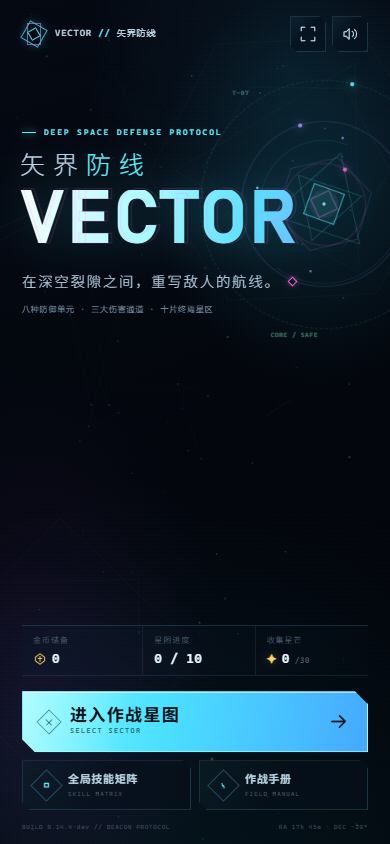
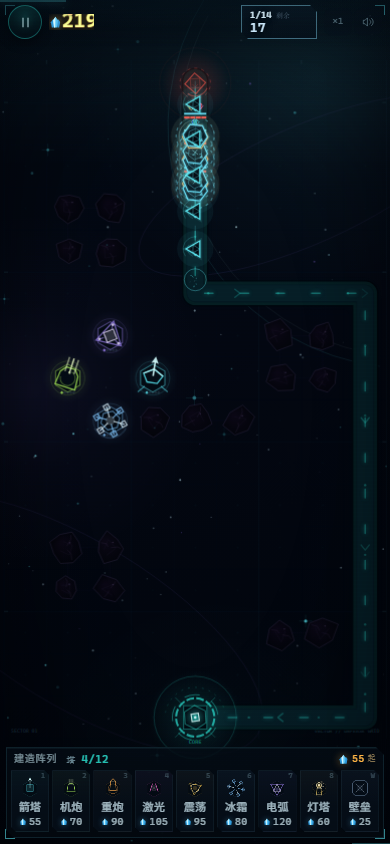

# VECTOR // 矢界防线

> 当前版本：**0.14.4-dev**（2026-10-28 起按 0.x 迭代）。扩容方向见 [扩容机制报告](docs/design/游戏扩容机制报告.md)。

一款可直接在浏览器运行的竖版深空塔防游戏。画面采用 2D 几何空心图形与霓虹线条风格，所有图形、图标、塔、敌人、特效和星空背景均由 Canvas / CSS 程序化绘制，没有外部图片、字体或音频素材。




## 运行

直接双击 `index.html` 即可游玩（经典脚本加载，不依赖构建工具）。

也可以在项目目录启动一个本地静态服务器：

```powershell
python -m http.server 5180 --bind 127.0.0.1
```

然后打开 <http://127.0.0.1:5180/>。

## 静态部署包

已生成并验证可直接上传的静态部署产物：

- `dist/`：部署目录，包含 `index.html`、`styles.css`、`manifest.json`、`icons/`、`src/` 与部署说明；
- [`release/vector-td-v0.14.4-dev-static.zip`](release/vector-td-v0.14.4-dev-static.zip)：压缩包，解压后即可作为静态站点内容；
- [`release/vector-td-v0.14.4-dev-static.zip.sha256`](release/vector-td-v0.14.4-dev-static.zip.sha256)：SHA-256 校验文件。

无需构建步骤、Node.js 或后端服务，可部署到 Nginx、Apache、Netlify、Vercel、Cloudflare Pages 或 GitHub Pages。具体说明见 `dist/README.md`。

## 玩法

- 守住屏幕底部的**星域核心**，清除每个星区的全部来袭波次。
- 点击底部防御阵列，再点击战场上的高亮星格部署。箭塔、机炮、重炮拥有不同射程与攻击模式；激光、震荡、冰霜、电弧各有独立机制；灯塔不攻击，但能揭示范围内的隐匿单位。
- 点击已建造的设施可以查看属性、升级到五级（灯塔可升阶一次），或回收。准备阶段或暂停期间最近部署的未升级设施（防御塔或壁垒）可全额撤销，其他回收返还 60% 投入。
- 防御塔和**偏折壁垒**都会阻挡敌人并迫使其重新寻路。游戏禁止封死全部从裂口通往核心的路径；利用墙体拉长航线，再把敌人送进交叉火力。
- 每局最多同时部署 **12 座防御塔**（灯塔占用 1 个塔位；偏折壁垒不占火力单元）。建造栏固定 9 个栏位：7 座攻击塔 + 灯塔 + 壁垒；四级、五级升级成本明显更高，后期需要在关键塔、灯塔位置与壁垒之间取舍。
- **部署撤销**：准备阶段或暂停期间，最后放下的未升级设施（防御塔或壁垒）可按原价全额撤销；放下其他设施或升级该塔后，回收只返还 60%。
- **无遮挡暂停**：按 `P` / `Esc` / `Space` 或左上暂停键只会冻结战场，主画面保持可见；暂停后左上按钮切换为恢复图标。HUD 分组固定：**暂停键 + 晶元居左，波次卡 + 倍速 + 音量居右**，暂停时中间剩余区域显示「重开 / 星图 / 敌情 / 全屏」四个图标；关卡标题不在 HUD 常驻，因此左右两组不会移动，**战场不会缩放或位移**。点击敌情图标在 HUD 下方展开本波次情报浮层，可随时关闭。**暂停期间仍可部署、升级和回收设施；暂停中刚部署的未升级设施可按原价撤销。** **进入关卡时默认处于暂停状态**，点击左上播放键、`P` / `Esc` / `Space` 后才开始倒计时。
- **核心状态按需浮现**：顶部不再常驻核心生命值数字。核心受击时顶部短暂浮现完整度、地面边缘闪红并出现受击方向提示；低于 30% 持续警示，低于 10% 进一步强化红光与音效；点击战场底部的核心可随时查看完整度与漏怪统计。
- **右键取消选择**：鼠标右键可取消当前建造/设施选择，左键仍用于建造或选中设施。
- **经济收束**：局内总晶元收入比 1.6.2 明显收紧，起始晶元下调；后期不能靠资源溢出把全部防御塔堆到满级。
- **全屏沉浸战场**：主游戏页不再有占据布局的 header / footer。Canvas 铺满整个视口，HUD 以透明渐变浮在顶部、不形成实色横条；**下方建造栏常驻**为半透明浮动面板，直接展示全部栏位、容量与最低费用。
- **手机全屏沉浸**：手机进入关卡时自动请求全屏，首页右上角与暂停时 HUD 中间的「全屏」图标可随时切换；全屏下自适应刘海安全区、隐藏浏览器工具栏并保持竖屏、在交战期间保持屏幕常亮。iPhone / iPad 可通过「分享 → 添加到主屏幕」以独立全屏应用启动。
- **续战**：暂停后返回星图或主界面，本局会保留在内存中；星图与首页会显示「继续作战」，可回到原来的波次、晶元与防线继续。
- **新特性简报**：首次进入引入新特性的星区时弹出对应简报（分裂 / 能抗 / 护盾 / 隐匿 / 魔免 / 霸体 / 终焉），包含特性说明与克制建议；已读后不再重复。
- **单次部署**：每次成功放置防御单元后自动取消建造选中，避免误触连续部署。
- **移动端字号**：HUD 数值、建造名称/价格、关卡信息与提示文字整体上调，并针对 320–562px 宽度重新适配。
- **可读性与路径**：路径为低亮度发光通道与低频流动粒子，固定箭头减到每三格一个；HUD 只保留金色晶元、波次/倒计时与白色战斗数值，核心青色、危险红色；敌人、核心受击与当前选中设施拥有更高的视觉优先级；障碍物压暗、可建位保留虚线框与十字标记。
- **建造栏层级**：建造栏保留背景与基本布局，但降低外围面板和普通卡片的透明度与边框亮度；选中、悬停、资源不足时才高亮对应卡片，名称、图标与价格始终可读。
- **详情不遮挡战场**：选中建造卡片或已建设施时，详情面板接管建造栏所在的底部条带（与建造栏同宽、同底、同高），不再浮在战场上方；战场最下方两行始终可见、可点击建造。取消、部署完成或点击空白处后恢复 9 栏建造栏。
- 击杀敌人获得**晶元**，用于建造和升级；完成星区获得**金币**，用于全局技能矩阵。
- **更长战役**：每个星区在原有编排上追加 6 个强化波次，单关扩展到 14–20 波；波次人口 ×1.45，敌人更多、单波持续时间更长。
- **波次自动推进**：每局开始有 25 秒初始部署时间，之后每波清空后有 12 秒整备时间。倒计时结束前 3 秒发出警报，归零后自动发兵；点击顶部倒计时卡可以立即提前发兵，**暂停时点击该卡会同时恢复作战并立即发兵**。暂停后点击 HUD 中间的「敌情」图标查看本波次敌人构成与特性。

### 伤害类型与敌人特性

防御塔分为三大伤害通道：

| 类型 | 塔 | 对护盾 | 定位 |
| --- | --- | ---: | --- |
| 动能 | 棱镜、机炮、重炮 | ×0.45 | 实体弹道；破盾差，但能穿透魔免 |
| 能量 | 激光、震荡、电弧 | ×1.90 | 破盾快；被魔免 / 能抗削弱 |
| 低温 | 冰冻 | ×0.90 | 伤害低，主要提供减速 |

敌人特性：

- **护盾**：独立护盾条；能量 ×1.9、动能 ×0.45、低温 ×0.9。用激光 / 电弧 / 震荡破盾。
- **物免**：动能伤害按单位减免（重棱 40%、铁壁 65%）。用能量或低温。
- **魔免**：能量与低温伤害减免 75%。用棱镜 / 机炮 / 重炮。
- **能抗**：能量伤害降低 40%。用动能或低温。
- **能量易伤**：受到的能量伤害 +20%。用激光 / 电弧 / 震荡。
- **霸体**：免疫所有减速。冻结 / 震荡的控制无效，用纯伤害塔。
- **隐匿**：常规索敌无法锁定。必须由灯塔的侦测范围揭示，其他塔不再自带反隐。
- **分裂**：死亡时分裂为两个高速残片。用重炮 / 震荡 / 电弧清理。
- **终焉**：最终首领，护盾 + 霸体 + 能抗，需要动能与能量混编。

### 灯塔与反隐

- **灯塔**：60 晶元，侦测半径 3.5 格，不攻击，占用 1 个塔位；可花费 125 晶元升阶为「远侦灯塔」，侦测半径扩大到 4.5 格。
- 灯塔半径内的隐匿单位会被揭示，所有防御塔都能锁定并攻击它们；离开范围会重新隐匿。
- 其他防御塔不再自带反隐。多裂口地图可能需要多座灯塔覆盖不同航线。

### 塔的五级视觉

五级不再只靠星星区分：

- I 级：单层几何主体、最简轮廓。
- II 级：稳定环、内层轮廓、第一组附加结构。
- III 级：四向校准刻度、断环、侧舱 / 副炮 / 聚焦鳍。
- IV 级：反向轨道、3 个轨道节点、装甲 / 散热 / 侧透镜，弹道出现曳光与额外冲击环。
- V 级：八点光环、五角星冠、4 个轨道节点、脉冲核心与罗马数字 V；每座塔还有专属弹道 / 双束 / 多环爆炸。

### 全局技能

共有七条全局技能线，每条五阶，使用金币永久升级：

- 核心装甲：核心最大完整度 +20 / 阶（满阶 +100）
- 晶体共振：击杀晶元 +10% / 阶（满阶 +50%）
- 武器超频：所有防御塔伤害 +8% / 阶（满阶 +40%）
- 建造协议：建造与升级费用 -5% / 阶（满阶 -25%）
- 静滞场域：敌人移动速度 -4% / 阶（满阶 -20%）
- 纳米修复：每波结束修复 6 点完整度（满阶 30）
- 初始电容：每局起始晶元 +25（满阶 +125）

技能会在下一局生效。战斗中的晶元不会跨局保留。**技能矩阵支持重置**：重置后所有技能回到 0 阶，并按已投入金币全额返还（重置按钮位于技能列表底部，需要二次点击确认）。

### 敌情

- **游隼**：高速低生命三角单位。
- **棱卫**：均衡的方形护卫。
- **重棱**：高生命六边形重甲，物免 40%、能量易伤 20%。
- **裂变体**：死亡时分裂成两个高速残片。
- **相位哨卫**：能量抗性 40%，削弱激光、电弧和震荡伤害。
- **折光盾卫**：独立护盾条，能量武器破盾快，动能被偏折。
- **幽影**：隐匿单位，常规索敌无法锁定，需要灯塔揭示。
- **虚空织者**：魔免 75%，必须用动能火力。
- **铁壁**：霸体 + 物免 65%，免疫减速。
- **终焉棱镜**：第十星区最终首领，护盾 + 霸体 + 能抗 + 动能抗性。

### 操作

| 操作 | 桌面端 | 触屏 |
| --- | --- | --- |
| 选择防御塔 | `1`–`8` | 点击底部卡片 |
| 选择壁垒 | `W` | 点击壁垒卡片 |
| 部署 | 点击星格 | 点击星格 |
| 查看 / 升级 / 回收 | 点击已建造设施 | 点击已建造设施 |
| 选择建造单元 | 底部常驻建造栏 / 数字键 | 底部常驻建造栏 |
| 取消当前选择 | 鼠标右键 | 点击空白处 / 取消按钮 |
| 查看核心状态 | 点击战场底部核心 | 点按战场底部核心 |
| 立即发兵 | 点击顶部倒计时 | 点击顶部倒计时 |
| 查看当前波次敌情 | 暂停后点击 HUD 中间「敌情」图标 | 暂停后点按 HUD 中间「敌情」图标 |
| 暂停 / 恢复 | `P` / `Esc` / `Space` | 点击左上暂停按钮 |
| 切换倍速 | 点击 `×1` 按钮 | 点击 `×1` 按钮 |

波次默认自动推进：顶部显示自动发兵倒计时和进度条；剩余 3 秒时变红并发出警报，随后自动发兵。玩家也可以点击顶部倒计时卡立即发兵；暂停时点击该卡会恢复作战并立即发兵。暂停会冻结倒计时；HUD 左侧保持暂停键与晶元，右侧保持波次卡、倍速与音量，中间显示「重开 / 星图 / 敌情 / 全屏」四个图标。点击敌情图标在 HUD 下方展开本波次的敌人构成、特性徽章与克制关系。关卡标题不在 HUD 常驻，暂停和情报浮层都不会改变战场尺寸，网格不会缩放或下移。每关进入时默认暂停，`P`、`Esc` 与 `Space` 均可暂停 / 恢复。

第一局会显示部署协议。作战手册中可查看资源、路径规则、伤害类型、敌人特性、塔图鉴、波次节奏与快捷操作。

## 星区

共 10 个星区。每个星区拥有独立地图、裂口数量、波次编排、主题色与难度。完成一个星区会解锁下一个，并进行 1–3 星评价：

- 完整度 ≥ 80%：3 星
- 完整度 ≥ 40%：2 星
- 其余通关：1 星

首次肃清获得完整金币与星数加成；重复通关获得部分回收金币。进度、星级、金币与全局技能保存在浏览器 `localStorage` 中。

## 调试模式

1.7.0 引入的可视化调试模式，默认只在本地开发环境开启：

- `localhost` / `127.0.0.1` / `file://` 打开时默认开启；
- URL 加 `?debug=1` 强制开启，`?debug=0` 强制关闭；
- 快捷键 `Ctrl + Shift + D` 开关；
- 首页顶部 `DEBUG` 按钮，或游戏内 HUD 的 `DBG` 按钮打开面板。

调试面板支持：

- 直达任意关卡（不受星区解锁限制）；
- **初始赠送 10000 金币**（每个浏览器档案一次），技能升级按正常费用消耗；一键全 5 阶、一键重置；
- +1000 金币、解锁全部星区；
- 局内 +500 晶元、修复核心 +50、攻击塔 5 级（灯塔不参与）、准备时间 30 秒；
- 无敌核心、免费建造 / 升级；
- 立即发兵、清空敌军、直接胜利 / 直接失败；
- 生成 5 个指定类型的测试敌群。

调试模式下的战斗不写入星图进度、星级或金币，避免污染正式存档。

## 项目结构

```text
index.html          页面骨架、UI 与内联 SVG 图标
styles.css          界面、响应式布局、霓虹视觉与动效
src/config.js       防御塔、敌人、伤害类型、特性、技能、10 个关卡与波次数据
src/util.js         数学、颜色、几何绘制与随机数工具
src/pathgrid.js     网格、BFS 流场寻路与建造合法性验证
src/audio.js        Web Audio 程序化音效
src/render.js       Canvas 战场渲染器、五级塔体、特性敌人与弹道
src/game.js         战斗模拟、护盾/抗性/隐匿结算、塔/敌/弹道、调试 API
src/app.js          界面导航、存档、金币技能、调试面板、输入与主循环
docs/design/        策划总案、单位图鉴与扩容文档
docs/deployment.md  游戏专属部署文档
docs/prd/           UI/视觉评审文档
```

`docs/design/`（策划与图鉴）：

```text
docs/design/游戏策划文档.md   玩法、关卡、数值、视觉与验收
docs/design/单位图鉴.md       防御塔与敌人的完整数据
```

## 开发备注

没有 npm 依赖，也不需要构建。若使用本地 HTTP 服务，修改文件后刷新页面即可。游戏以 `9 × 16` 的竖版网格为设计基准；窄屏和短屏会自动压缩界面，并在高度不超过 740px 时把设施详情改为悬浮面板，以尽量扩大战场。

测试调试入口在控制台：

```js
__VECTOR.game              // 当前战斗实例
__VECTOR.save              // 存档对象
__VECTOR.addGold(500)      // 增加金币
__VECTOR.unlockAll()       // 解锁全部星区
__VECTOR.debug.enabled     // 是否处于调试模式
__VECTOR.debug.maxSkills() // 全技能 5 阶
__VECTOR.debug.spawn('wraith', 5) // 生成测试敌群
__VECTOR.debug.win()       // 直接胜利
```

完整调试 API 见 `src/app.js` 末尾的 `window.__VECTOR`，以及 `docs/design/游戏策划文档.md` 的“调试模式”一节。
