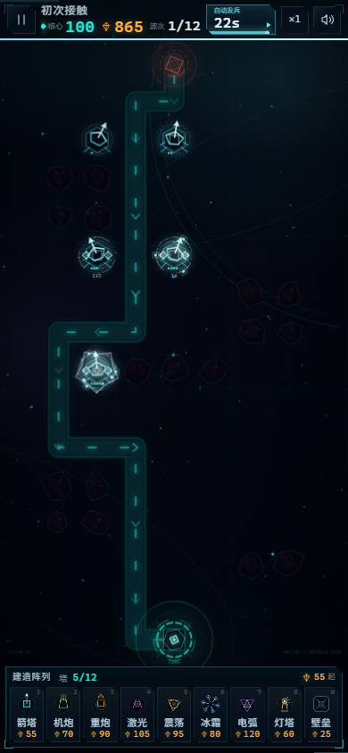
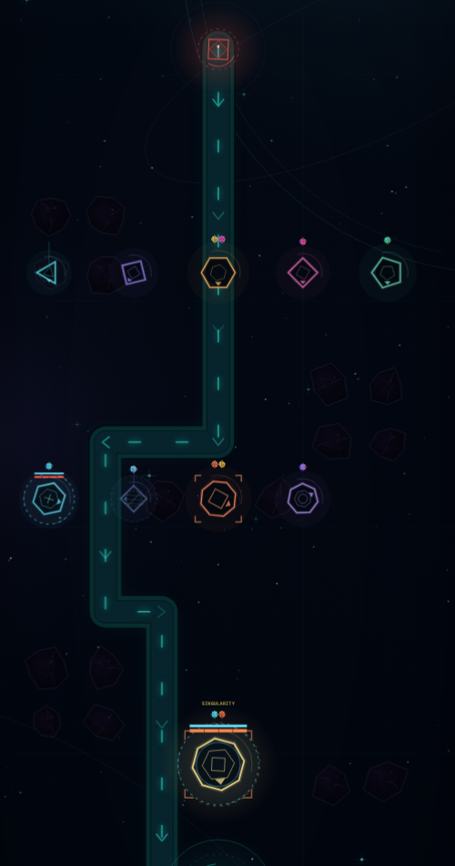

# VECTOR // 矢界防线 — 游戏策划文档

> 版本：1.8.0 · 文档日期：2026-10-28  
> 对应构建：`BUILD 1.8.0 // BEACON PROTOCOL`  
> 当前项目构建：**0.14.4-dev**（开发线；本文为 1.8.0 起的策划快照 + 0.14.x 平衡修正，具体数值以 `src/config.js` 为准）  
> 配套文档：[单位图鉴](单位图鉴.md) · [部署说明](../../docs/deployment.md) · [游戏 README](../../README.md)

---

## 0. 文档信息

| 项目 | 内容 |
| --- | --- |
| 游戏名 | VECTOR // 矢界防线 |
| 类型 | 竖版深空塔防 / 路径改写 / 轻量局外成长 |
| 平台 | 移动优先的纯静态 Web（Canvas 2D + 原生 JavaScript） |
| 单局时长 | 约 16–28 分钟（14–20 波） |
| 当前版本 | 1.8.0 |
| 文档范围 | 玩法、关卡、数值、视觉反馈、调试与验收 |
| 数据源 | `vector-td/src/config.js`、`vector-td/src/game.js`、`vector-td/src/render.js` |

本文件是 1.8.0 的**策划总案**，面向后续调参、关卡扩展与验收。所有具体单位数值以 [单位图鉴](单位图鉴.md) 和 `vector-td/src/config.js` 为准；本文中的表格用于解释设计意图与曲线，不替代代码。

---

## 1. 设计概览

### 1.1 一句话定位

在一张 9 × 16 的深空网格上，用七种攻击塔、灯塔、偏折壁垒和三大伤害通道，挡住十片星区的敌群，守住底部的星域核心。

### 1.2 核心体验

- **改写航线**：塔和壁垒都占格，会迫使敌人重新寻路；玩家用建筑“画”出更长的路线与交叉火力。
- **克制决策**：敌人拥有护盾、韧性、隐匿、物免、魔免等特性，单一塔种会被针对，必须混编动能 / 能量 / 低温。
- **五阶进化**：同一座塔从 I 到 V 级不仅数值提升，塔体轮廓、光环、卫星、弹道和命中特效都会逐级变化。
- **短局可读**：全屏 Canvas、透明 HUD、常驻建造栏；进入关卡默认暂停，暂停不遮挡战场，倒计时自动发兵。
- **长期成长**：金币只用于七条全局技能线；技能在下一局生效，帮助玩家跨过后期星区的数值与特性门槛。

### 1.3 设计支柱

1. **路线优先于数值**：好的建筑布局比单纯堆塔更有效。
2. **克制优先于堆叠**：先看敌情特性，再决定塔种与伤害通道。
3. **视觉优先于文字**：塔的等级、敌人的特性必须在战场上能一眼分辨。
4. **失败可解释**：玩家能说出“这波为什么漏”，而不是只看到核心归零。
5. **调试可复现**：开发期能直达任意关卡、任意加点、任意生成敌群。

### 1.4 目标玩家与单局节奏

- 喜欢塔防、路径规划、轻 Rogue-lite 成长的移动端玩家。
- 单局结构：进入关卡暂停 → 点击播放开始 25 秒初始部署 → 12 秒波间整备 → 自动发兵 → 清空后进入下一波。
- 失败成本低：可重开、可倍速、可随时暂停；局外成长永久保留。
- 操作负担低：主要交互是“选塔 → 点格 → 升级 / 回收”，没有需要持续点击的技能。

### 1.5 1.7.0 版本目标

针对 1.6.2 的反馈，1.7.0 要解决四件事：

1. **数值过软**：玩家不点全局技能也能通关。→ 收紧局内收入、提高后期单位质量、引入特性克制。
2. **塔的等级只靠星星区分**：视觉不明显。→ 五级塔体轮廓 + 光环 + 卫星 + 弹道分级。
3. **敌人机制单一**：只有能量抗性与分裂。→ 增加护盾、韧性、隐匿、物免、魔免、能量易伤。
4. **调试低效**：只能改控制台变量。→ 可视化调试面板，任意关卡、任意加点、任意生成敌群。

### 1.6 1.8.0 反隐体系调整

1.8.0 新增不可升级的**灯塔**：

- 灯塔拥有 3.5 格侦测半径；半径内的隐匿单位会被揭示，所有攻击塔都能锁定并伤害它们。
- 灯塔不攻击、不可升级，占用 1 个防御塔位（12 座上限内）。
- 其他防御塔不再自带反隐；激光 / 电弧 / 震荡 / 棱镜 V 级的显隐能力全部移除。
- 隐匿敌人离开灯塔范围后会重新隐匿。多裂口地图可能需要第二座灯塔覆盖另一条航线。
- 建造栏从 8 格扩展为 9 格：7 座攻击塔 + 灯塔 + 壁垒。

---

## 2. 玩法策划

### 2.1 核心循环

```text
选择星区
  ↓
准备阶段（25s / 12s）：建造、升级、回收、用壁垒改写航线
  ↓
自动发兵（可点击倒计时提前发兵）
  ↓
交战：索敌 → 伤害类型结算 → 护盾/抗性/特性 → 击杀获得晶元
  ↓
清空波次 → 修复（纳米修复）→ 下一波
  ↓
守住核心 → 结算星级与金币 → 解锁下一星区
  ↓
金币投入全局技能矩阵 → 下一局更强
```

### 2.2 两种资源

| 资源 | 获取 | 使用 | 是否跨局 |
| --- | --- | --- | --- |
| 晶元 | 击杀敌人、关卡起始晶元 | 建造、升级、壁垒 | 否，每局重置 |
| 金币 | 首次 / 重复通关星区、星级奖励 | 七条全局技能线 | 是，永久保存 |

设计意图：

- 晶元只影响单局节奏，避免“越玩越富”导致局内无压力。
- 金币只影响长期成长，不直接变成局内战力，避免付费式滚雪球。
- 1.7.0 的核心改动是**降低晶元总收入**，让玩家在“多建一座低阶塔”与“升级一座高阶塔”之间做取舍。

### 2.3 建造、升级与回收

- 每局最多同时存在 **12 座防御塔**（含灯塔）；偏折壁垒不占火力单元。
- 建造：选中建造栏卡片 → 点击高亮星格；右键 / 空白处取消。
- 升级：点击已建塔 → 升级；攻击塔最高 V 级，灯塔可升阶一次（125 晶元，侦测半径 3.5 → 4.5）。
- 回收：
  - 准备阶段或暂停期间最后放下的一座**未升级设施（防御塔或壁垒）**可全额撤销；
  - 其他情况返还 60% 投入。
- 升级成本：II–V 级分别乘以 `1.0 / 1.3 / 2.0 / 3.2` 的阶梯系数（见 `UPGRADE_COST_MULTIPLIERS`），后期升级明显更贵。
- 暂停期间仍可建造、升级、回收，方便长考；暂停中刚部署的未升级设施（塔或壁垒）可按原价撤销。

### 2.4 航线与壁垒

- 网格为 9 列 × 16 行；敌人从顶部裂口进入，沿 BFS 流场走向底部核心。
- 塔和壁垒都会阻挡敌人，迫使重新寻路。
- 系统禁止封死所有“裂口 → 核心”的通路；也禁止把场上敌人困死。
- 偏折壁垒不攻击、不占塔位，只用于拉长航线、制造转角与交叉火力。
- 灯塔占 1 个塔位、不攻击，只用于揭示范围内的隐匿单位；可升阶一次扩大半径。
- 路径渲染为发光通道 + 流动箭头；障碍物保持暗色、无发光，避免误导玩家以为可以建造。

### 2.5 波次节奏

- 每局开始有 **25 秒**初始部署时间；进入关卡时默认暂停，点击播放后才开始倒计时。
- 每波清空后有 **12 秒**整备时间。
- 剩余 3 秒发出警报；倒计时归零自动发兵。
- 点击顶部倒计时卡可立即发兵；交战期间点击同一张卡可查看当前波次的敌人构成与特性。
- 支持 ×1 / ×2 / ×3 倍速；暂停冻结倒计时（`P` / `Esc` / `Space`）。

### 2.6 防御单位定位

| 塔 | 伤害 | 建造 | I 级 DPS | V 级累计投入 | V 级基础 DPS | 核心定位 |
| --- | --- | ---: | ---: | ---: | ---: | --- |
| 棱镜箭塔 PRISM | 动能 | 55 | 20.7 | 1120 | 448.5（双目标合计） | 廉价基线、魔免杀手 |
| 矢量机炮 GATLING | 动能 | 70 | 30.0 | 1380 | 315.4 | 持续单体、近距离压制、魔免 |
| 引力重炮 CANNON | 动能 | 90 | 16.0 | 1736 | 140.0（范围） | 群伤、分裂体、高生命 |
| 相干激光 LASER | 能量 | 105 | 18.0 | 1991 | 122.0（满升温 ×2.7 ≈ 329） | 护盾 / 物免 |
| 谐振震荡 SHOCK | 能量 | 95 | 9.3 | 1827 | 83.8（范围） | 近域群伤、护盾 |
| 熵减冻结 FROST | 低温 | 80 | 4.5 | 1518 | 40.0（多目标） | 减速控制、高速单位 |
| 链式电弧 TESLA | 能量 | 120 | 13.8 | 2325 | 143.5（链式合计更高） | 连锁、护盾、物免 |
| 灯塔 BEACON | 支援 | 60 | — | — | — | 揭示 3.5（升阶 4.5）格内隐匿；占 1 塔位 |

> DPS 为单体基础值；重炮、震荡、冻结、电弧的实际总伤害受范围 / 目标数 / 链数影响。完整逐级表见[单位图鉴](单位图鉴.md)。

设计意图：

- 三种动能塔共享“对护盾低效、对魔免有效”的通道特征，但分别覆盖单体、持续、范围。
- 三种能量塔共享“破盾、被魔免克制”的特征，但分别覆盖单体、近域、连锁。
- 冻结塔伤害最低，但提供不可替代的减速；高韧性单位让控制收益骤降，迫使玩家换纯伤害塔。
- 灯塔是唯一的反隐手段，不攻击、占 1 个塔位；可花费 125 晶元升阶为「远侦灯塔」（半径 3.5 → 4.5）。它的价值取决于覆盖位置，其次才是等级。

### 2.7 伤害类型与护盾

| 伤害类型 | 塔 | 对护盾倍率 | 设计定位 |
| --- | --- | ---: | --- |
| 动能 KINETIC | 棱镜、机炮、重炮 | ×0.45 | 实体弹道；破盾差，但能穿透魔免力场 |
| 能量 ENERGY | 激光、震荡、电弧 | ×1.90 | 高能光束；破盾快，但被魔免 / 能抗削弱 |
| 低温 CRYO | 冻结 | ×0.90 | 直接伤害低，主要提供减速 |

护盾规则：

- 护盾是独立于生命值的第二条耐久条，先于生命值被扣除。
- 护盾伤害按上表倍率结算；护盾被击穿后，溢出伤害按倍率折算回生命值。
- 护盾不享受敌人的抗性；抗性只作用于生命值伤害。
- 护盾破裂时播放独立特效、音效和“护盾破裂”浮字。

### 2.8 敌人特性

| 特性 | 效果 | 克制方式 |
| --- | --- | --- |
| 护盾 | 独立护盾条；能量 ×1.9、动能 ×0.45、低温 ×0.9 | 激光 / 电弧 / 震荡 |
| 物免 | 动能伤害按单位减免（重棱 40%、铁壁 65%） | 能量 / 低温 |
| 魔免 | 能量与低温伤害减免 75% | 棱镜 / 机炮 / 重炮 |
| 能抗 | 能量伤害降低 40% | 动能 / 低温 |
| 能量易伤 | 受到的能量伤害 +20% | 激光 / 电弧 / 震荡 |
| 韧性 | 按比例减免减速与击退（铁壁 80%、终焉 100%） | 纯伤害塔；控制收益大幅缩水 |
| 隐匿 | 常规索敌无法锁定；仅灯塔范围内可被命中 | 灯塔 |
| 分裂 | 死亡时分裂为两个高速残片 | 重炮 / 震荡 / 电弧等范围火力 |
| 终焉 | 最终首领；护盾 + 韧性 100% | 动能破甲 + 能量破盾的混编火力 |

设计原则：

- 大多数特性有**至少两种**可用答案；隐匿是例外，只有灯塔能揭示，但灯塔可重复建造、需要覆盖航线。
- 特性的视觉必须独立于颜色：护盾泡、韧性角括号、隐匿虚线、特性徽章。
- 特性可以叠加，但同一波内不会让玩家同时面对全部七个特性（教学关除外）。

### 2.9 克制矩阵

图例：● 强克制 / 高效；○ 可用 / 中性；× 低效 / 被克制。

| 塔 \ 敌人 | 高速 | 群 / 分裂 | 护盾 | 物免 | 魔免 | 韧性 | 隐匿 | 首领 |
| --- | :---: | :---: | :---: | :---: | :---: | :---: | :---: | :---: |
| 棱镜 | ● | ○ | × | × | ● | ○ | × | ○ |
| 机炮 | ● | ○ | × | × | ● | ○ | × | ○ |
| 重炮 | × | ● | × | × | ● | ● | × | ○ |
| 激光 | ○ | × | ● | ● | × | ● | × | ● |
| 震荡 | ○ | ● | ● | ● | × | ○（控制浪费） | × | ○ |
| 冻结 | ● | ● | ○ | ○ | × | × | × | × |
| 电弧 | ○ | ● | ● | ● | × | ○ | × | ○ |
| 灯塔 | — | — | — | — | — | — | 揭示 | — |

> 隐匿列：没有灯塔时所有攻击塔都无法命中；灯塔范围内的隐匿单位可被任意攻击塔正常锁定与伤害。棱镜 V 级、激光、电弧、震荡都不再自带反隐。

### 2.10 全局技能矩阵

七条技能线，每条五阶，使用金币永久升级，下一局生效。

| 技能 | 每阶效果 | 五阶总成本 | 满阶效果 | 定位 |
| --- | --- | ---: | --- | --- |
| 核心装甲 | +20 最大完整度 | 610 | +100 | 容错 |
| 晶体共振 | +10% 击杀晶元 | 610 | +50% | 经济 |
| 武器超频 | +8% 全塔伤害 | 745 | +40% | 输出 |
| 建造协议 | -5% 建造 / 升级费用 | 685 | -25% | 经济 |
| 静滞场域 | -4% 敌人移速 | 630 | -20% | 控制 |
| 纳米修复 | 每波结束 +6 完整度 | 720 | +30 / 波 | 续航 |
| 初始电容 | 开局 +25 晶元 | 580 | +125 | 开局节奏 |

技能树总成本 **4,580 金币**。金币来源：十关首通 2,100 + 满星奖励 300 + 重复通关按 30% 回收。设计目标是“首通全部星区后，技能树约完成一半；再通过 2–3 次重复通关补满关键线”。

**技能重置**：技能矩阵底部提供重置入口，二次确认后所有技能回到 0 阶，并按各技能已购买的阶数逐阶累计，全额返还金币。重置只影响永久技能，不影响星图进度与局内状态。

### 2.11 难度、评价与失败

- 失败条件：核心完整度归零。
- 星级：
  - 完整度 ≥ 80%：3 星
  - 完整度 ≥ 40%：2 星
  - 其余通关：1 星
- 首次肃清获得完整金币 + 星级奖励；重复通关获得 30% 基础金币 + 星级提升奖励。
- 1.7.0 的难度目标：
  - 无技能：可稳定通过 L1–L3，L4 开始明显吃力。
  - 2 阶技能：可通过 L4。
  - 3 阶技能：可通过 L5–L8（越靠后越依赖克制与布局）。
  - 4 阶技能：可通过 L9；L10 仍需要接近满阶或更优操作。
  - 满阶技能：L10 有明确但可控的压力。

### 2.12 调试模式

1.7.0 引入、1.8.0 保留的可视化调试模式，面向开发与验收，不属于正常玩法。

- **默认开启条件**：`localhost` / `127.0.0.1` / `file://` / 空 host。
- **强制开关**：URL `?debug=1` / `?debug=0`；快捷键 `Ctrl + Shift + D`；状态写入 `localStorage` 键 `vector_geotd_debug_v1`。
- **入口**：首页顶部 `DEBUG` 按钮；游戏内 HUD 的 `DBG` 按钮。
- **能力**：
  - 直达任意关卡（不受解锁限制）；
  - **首次启用调试模式时赠送 10000 金币**（每个浏览器档案一次，记录在 `vector_geotd_debug_gold_v1`）；技能升级按正常费用消耗；
  - 一键全 5 阶、一键重置（调试面板的重置为开发快捷操作，不返还金币；玩家向重置在技能矩阵内并全额返还）；
  - +1000 金币、解锁全部星区；
  - 局内 +500 晶元、修复核心 +50、攻击塔 5 级（灯塔不参与）、准备时间 30 秒；
  - 无敌核心、免费建造 / 升级；
  - 立即发兵、清空敌军、直接胜利 / 直接失败；
  - 生成 5 个指定类型的测试敌群。
- **存档隔离**：调试模式下的战斗不写入星级、进度或金币，避免污染正式存档。
- **控制台 API**：`__VECTOR.debug.*`，详见 `vector-td/src/app.js` 末尾。

---

## 3. 关卡策划

### 3.1 结构总表

| 关 | 星区 | 裂口 | 波次 | 起始晶元 | HP 系数 | 后期 HP | 密度 | 奖励系数 | 总有效 HP | 总收入 | HP / 收入 | 首通金币 | 新机制 |
| ---: | --- | :---: | :---: | ---: | ---: | ---: | ---: | ---: | ---: | ---: | ---: | ---: | --- |
| 1 | 初次接触 | 1 | 14 | 140 | 0.85 | 0.12 | 1.00 | 1.05 | 6,861 | 701 | 9.8 | 80 | 基础循环 |
| 2 | 双生航路 | 2 | 15 | 155 | 1.00 | 0.20 | 1.00 | 1.05 | 13,534 | 975 | 13.9 | 100 | 双裂口、分裂 |
| 3 | 棱镜回廊 | 2 | 16 | 180 | 1.10 | 0.25 | 1.00 | 1.10 | 20,618 | 1,295 | 15.9 | 120 | 能抗 40% |
| 4 | 日冕风暴 | 1 | 16 | 185 | 1.35 | 0.40 | 1.00 | 1.05 | 29,405 | 1,328 | 22.1 | 145 | 护盾 |
| 5 | 碎裂星带 | 3 | 17 | 200 | 1.55 | 0.50 | 1.00 | 1.05 | 37,384 | 1,565 | 23.9 | 170 | 隐匿 |
| 6 | 离子矿脉 | 2 | 17 | 215 | 1.75 | 0.60 | 1.00 | 1.10 | 52,193 | 1,888 | 27.6 | 200 | 魔免 75% |
| 7 | 镜像深渊 | 2 | 18 | 240 | 1.90 | 0.65 | 0.80 | 1.10 | 57,904 | 1,727 | 33.5 | 240 | 韧性 80% + 物免 |
| 8 | 事件视界 | 2 | 18 | 280 | 2.00 | 0.55 | 0.70 | 1.25 | 72,922 | 2,399 | 30.4 | 285 | 特性组合 |
| 9 | 霓虹安魂曲 | 3 | 19 | 340 | 2.10 | 0.55 | 0.66 | 1.40 | 112,165 | 3,773 | 29.7 | 340 | 全特性混编 |
| 10 | 奇点降临 | 3 | 20 | 380 | 2.20 | 0.55 | 0.62 | 1.50 | 177,034 | 5,331 | 33.2 | 420 | 首领 |

> “总有效 HP”包含护盾；“总收入”= 起始晶元 + 全部击杀奖励（含波次成长系数）。HP/收入是粗粒度难度指标，不包含特性克制与操作成本，因此不是单调递增。

### 3.2 机制引入节奏

| 星区 | 引入 | 目的 |
| --- | --- | --- |
| 1 | 基础路径、建造、升级、回收 | 教学 |
| 2 | 双裂口、分裂体 | 让玩家理解“范围火力”和“分线防守” |
| 3 | 能抗 40% | 第一次让纯能量流吃亏 |
| 4 | 护盾 | 第一次让纯动能流吃亏；教学“先破盾再杀伤” |
| 5 | 隐匿 | 第一次要求灯塔；3.5 格侦测半径内的隐匿单位才可被命中 |
| 6 | 魔免 75% | 第一次让纯能量流几乎失效；必须补动能 |
| 7 | 韧性 80% + 物免 | 控制收益削减八成；必须补纯伤害 |
| 8 | 护盾 + 隐匿、韧性 + 魔免 | 组合克制，迫使玩家混编 |
| 9 | 全特性 | 终局压力测试 |
| 10 | 首领 | 护盾 + 韧性 100% + 能抗，检验完整阵容 |

每个新机制都会在该关的 `intel` 文案和作战手册中给出明确提示；首次出现时不会与另一个新机制同波。

### 3.3 地图设计原则

- 每张地图 9 × 16，至少保留一条从每个裂口到核心的通路。
- 障碍物（小行星）只用于分割空间，不承担“唯一解”的迷宫作用。
- 单裂口地图强调开阔与转角；多裂口地图强调分线、合流与交叉火力。
- 第 7 星区起降低波次密度（`density`），但提高单位质量与特性组合，避免屏幕单位过多。
- 第 10 星区使用对称的环形/十字地图，给首领留出长路径，同时避免单塔覆盖全图。

### 3.4 波次编排

- 基础波次 8–14 波，程序追加 6 个强化波，最终 14–20 波。
- 每个波次由 2–4 个 `type / count / gap` 组构成；组间追加 0.75 秒间隔。
- 波次 HP 成长：`1.035^(wave-1)`；星区内后期额外乘 `1 + lateWaveHp × progress²`。
- 追加波从该关中段抽取，数量为原波的 70%，作为节奏缓冲，不引入新特性。
- 波次人口系数 1.45：敌人数量增加约 45%，但出生间隔不变，波次持续时间同步拉长，瞬时压力基本不变。
- 人口补偿：非 Boss 单位生命 ×0.62、击杀晶元 ×0.64（Boss 豁免）。扩容后各关总有效 HP 仅比 1.12.x 高 2–8%，总收入高 2–7%，HP/收入比基本持平，避免“数量变多→晶元爆炸→数值碾压”。
- 第 7 星区起 `density` 降至 0.62–0.80，控制同屏数量与性能。
- 第 10 关最终波固定包含 1 个首领，不允许被额外波替换。

### 3.5 关卡逐个说明

#### L1 初次接触

- 单裂口、开阔地图，只有游隼 / 棱卫 / 重棱。
- 教学重点：建造、升级、回收、壁垒拉长航线。
- 无技能应能稳定通过；AI 基准 100/100 完整度。

#### L2 双生航路

- 两个裂口，首次出现裂变体。
- 教学重点：分线覆盖、范围火力清理残片。
- 裂变体死亡后生成 2 个高速残片，残片生命低但速度快。

#### L3 棱镜回廊

- 首次出现相位哨卫（能量抗性 40%）。
- 教学重点：不能只堆激光 / 电弧 / 震荡；补棱镜、机炮、重炮。
- 无技能 AI 基准可通关，完整度约 85–94/100，开始有压力。

#### L4 日冕风暴

- 首次出现折光盾卫（护盾 50% 最大生命）。
- 教学重点：能量破盾 ×1.9，动能破盾 ×0.45；先破盾再杀伤。
- 推荐至少 2 阶全局技能；无技能 AI 基准在波次 5–6 失守。

#### L5 碎裂星带

- 三裂口，首次出现幽影（隐匿）。
- 教学重点：建造灯塔覆盖主要航线；被揭示的幽影才能被攻击塔命中，其他塔不再自带反隐。
- 推荐 3 阶技能；无技能几乎无法处理隐匿波。

#### L6 离子矿脉

- 首次出现虚空织者（魔免 75%）。
- 教学重点：纯能量流会被魔免完全克制；必须保留 2–3 座动能塔。
- 推荐 3 阶技能。

#### L7 镜像深渊

- 首次出现铁壁（韧性 80% + 物免 65%）。
- 教学重点：冻结 / 震荡的控制对高韧性单位收益极低；用重炮、激光、电弧硬拆。
- 波次密度降至 0.80，但单位质量明显提高。

#### L8 事件视界

- 双裂口 + 长路径，特性组合开始叠加。
- 重点：护盾 + 隐匿、韧性 + 魔免同时出现，单一塔种会被完全克制。
- 推荐 3–4 阶技能。

#### L9 霓虹安魂曲

- 三裂口、全特性混编、17 波。
- 重点：根据每波预览切换建造重点；保留至少 1–2 座灯塔覆盖航线、2 座破盾、2 座动能。
- 推荐 4 阶技能；满阶可稳定通过。

#### L10 奇点降临

- 三裂口、18 波、最终首领。
- 重点：首领同时拥有护盾（50%）、韧性 100%、能抗 20%、动能抗性 25%；需要动能破甲 + 能量破盾的混编火力，并用灯塔覆盖首领路径上的隐匿波。
- 推荐 4–5 阶技能；满阶 AI 基准 200/200 完整度。

### 3.6 Boss 关设计

- 首领基础生命 4,800，护盾 50%（2,400），速度 0.30，基础伤害 50。
- 特性：护盾、韧性 100%、能抗 20%、动能抗性 25%。
- 最终波：1 首领 + 折光盾卫 + 铁壁 + 虚空织者 + 幽影的混编护卫。
- 设计意图：
  - 不允许靠单一控制链拖死；
  - 不允许靠纯能量或纯动能一路平推；
  - 首领的护盾条与 HP 条分离，玩家能清楚看到“破盾进度”。
- 失败反馈：首领抵达核心时造成高额完整度伤害并触发强震屏，明确告知“首领漏了”。

---

## 4. 数值策划

### 4.1 核心公式

以下公式来自 `vector-td/src/game.js`：

```text
敌人生命 = round(baseHP × hpScale × waveHpMul × (1 + lateWaveHp × p²) × 1.035^(wave-1))
p = (wave - 1) / (totalWaves - 1)

敌人速度 = baseSpeed × speedScale × 静滞场域系数 × 随机浮动(0.97–1.03) × (1 + lateWaveSpeed × p²)
敌人奖励 = round(baseReward × rewardScale × (1 + (wave-1) × 0.012))
敌人核心伤害 = round(baseDamage × (1 + (levelId-1) × 0.06))

护盾 = round(生命 × shield)
护盾伤害 = 原始伤害 × 伤害类型护盾倍率
生命伤害 = 原始伤害 × (1 - 抗性[类型])
```

- 抗性支持负值：`-0.20` 表示受到该类型伤害 ×1.20（能量易伤）。
- 护盾先扣盾，溢出伤害按护盾倍率折算回生命值。
- 塔伤害：`基础伤害 × 武器超频系数`。
- 建造 / 升级费用：`基础费用 × 建造协议系数`；升级再乘 `UPGRADE_COST_MULTIPLIERS`。

### 4.2 塔的投入与产出

| 塔 | 建造 | I 级 DPS | II 累计 | III 累计 | IV 累计 | V 累计 | V 级 DPS | V 级 DPS / 累计晶元 |
| --- | ---: | ---: | ---: | ---: | ---: | ---: | ---: | ---: |
| 棱镜 | 55 | 20.7 | 100 | 204 | 464 | 1,120 | 448.5 | 0.400 |
| 机炮 | 70 | 30.0 | 130 | 260 | 580 | 1,380 | 315.4 | 0.229 |
| 重炮 | 90 | 16.0 | 165 | 328 | 728 | 1,736 | 140.0 | 0.081 |
| 激光 | 105 | 18.0 | 190 | 379 | 839 | 1,991 | 122.0（满升温 329.4） | 0.061（满升温 0.165） |
| 震荡 | 95 | 9.3 | 175 | 351 | 771 | 1,827 | 83.8 | 0.046 |
| 冻结 | 80 | 4.5 | 145 | 288 | 638 | 1,518 | 40.0 | 0.026 |
| 电弧 | 120 | 13.8 | 220 | 441 | 981 | 2,325 | 143.5（五链 511.7） | 0.062（五链 0.220） |
| 灯塔 | 60 | — | — | — | — | — | — | — |

> 表中的“DPS / 累计晶元”只用于比较单体基础输出，不包含范围、链式、控制、破盾与反隐的战术价值。重炮、震荡、冻结、电弧的实际价值显著高于该比值；灯塔的 60 晶元买的是 3.5 格反隐覆盖与 1 个塔位机会成本，不参与 DPS 比较。

设计结论：

- **I–III 级性价比最高**，适合铺开覆盖；IV–V 级是“占满 12 塔位后的纵向提升”。
- 由于塔位上限为 12，后期必须升级；但升级成本阶梯让“全 V”成为奢侈目标。
- 塔的战术价值不能只用 DPS 衡量：激光 / 电弧 / 震荡的破盾、冻结的控场、重炮的群伤、灯塔的揭示，都在特定波次有不可替代性。

### 4.3 敌人基础数值

> 下表为**关卡系数之前**的基础值；实际数值还要乘关卡 `hpScale` / `rewardScale` / 波次成长。完整逐关数值见[单位图鉴](单位图鉴.md)。

| 敌人 | HP | 护盾 | 速度 | 奖励 | 核心伤害 | 特性 | 首次出现 |
| --- | ---: | ---: | ---: | ---: | ---: | --- | ---: |
| 游隼 | 30 | 0 | 1.18 | 3 | 5 | — | L1 |
| 棱卫 | 60 | 0 | 0.86 | 4 | 6 | — | L1 |
| 重棱 | 190 | 0 | 0.50 | 8 | 13 | 物免 40% · 能量易伤 20% | L1 |
| 裂变体 | 100 | 0 | 0.74 | 6 | 8 | 分裂 | L2 |
| 残片 | 22 | 0 | 1.34 | 1 | 3 | — | L2 |
| 相位哨卫 | 150 | 0 | 0.62 | 9 | 11 | 能抗 40% | L3 |
| 折光盾卫 | 130 | 65 | 0.58 | 11 | 12 | 护盾 50% | L4 |
| 幽影 | 65 | 0 | 1.05 | 7 | 8 | 隐匿 | L5 |
| 虚空织者 | 180 | 0 | 0.70 | 12 | 15 | 魔免 75% | L6 |
| 铁壁 | 380 | 0 | 0.40 | 13 | 18 | 韧性 80% · 物免 65% | L7 |
| 终焉棱镜 | 4,800 | 2,400 | 0.30 | 180 | 50 | 护盾 50% · 韧性 100% · 能抗 20% · 动能抗性 25% | L10 |

### 4.4 战役难度曲线

| 指标 | 1.6.2 | 1.7.0 | 变化 |
| --- | ---: | ---: | ---: |
| 十关总有效 HP | ≈563,000 | ≈559,000 | ≈ -1% |
| 十关总晶元收入 | ≈37,400 | ≈20,100 | ≈ -46% |
| 平均 HP / 收入 | ≈15.1 | ≈27.8 | ≈ +84% |
| 敌人特性数量 | 2（分裂、能抗） | 7（+护盾、韧性、隐匿、魔免、能量易伤） | +5 |
| 塔等级视觉区分 | 星星 + 少量细节 | I–V 轮廓 / 光环 / 卫星 / 弹道 | 重做 |
| 全局技能满阶伤害 | +30% | +40% | +10pp |
| 无技能通关上限 | 全十关 | L1–L3 | 收紧 |

核心结论：

- 总敌血与旧版接近，但**总收入几乎减半**，玩家无法再靠资源溢出把 12 座塔全部堆满。
- 特性系统让“有效 HP”高于面板 HP：护盾、抗性、隐匿、韧性都会让错误的塔种输出大打折扣。
- 因此，1.7.0 的难度提升主要来自**经济收紧 + 特性克制 + 技能门槛**，而不是单纯把敌人血量翻倍。
- 1.8.0 新增灯塔后，隐匿不再由攻击塔自带，而是由 60 晶元的支援塔提供；L5–L9 的 3 阶通关余量有所提高，L10 仍需要 4–5 阶技能与正确的灯塔覆盖。

### 4.5 经济模型

单局收入：

```text
局内收入 = 起始晶元 + Σ(击杀奖励)
```

- 起始晶元：140（L1）→ 380（L10）。
- 击杀奖励随关卡 `rewardScale`（1.05–1.50）与波次成长（每波 +1.2%）提升。
- 12 座塔全建 I 级的最低成本约 660–720（含灯塔）。混合阵容约 900–1,100。
- 12 座塔全 V 的混合成本约 13,000–20,000，远超单局收入；因此后期只能选择性升级。
- 推荐支出结构：
  - 前 3 波：6–8 座 I–II 级塔，优先覆盖与克制；
  - 中段：补足灯塔覆盖 / 破盾 / 动能位，核心塔升 III–IV；
  - 后段：把 2–4 座关键塔升 V，而不是平均升级。

局外金币：

- 首通十关：2,100 金币；满星额外 300；共 2,400。
- 重复通关：基础金币的 30%，全通一轮约 630。
- 技能树总成本 4,580；首通 + 1 次重复约 3,030，可完成约 2/3；再 2 次左右可满关键线。
- 设计意图：让玩家在“先点哪条线”上做选择，而不是首通即满。

### 4.6 技能收益

| 技能 | 每阶 | 满阶 | 相对收益 | 适用阶段 |
| --- | ---: | ---: | --- | --- |
| 核心装甲 | +20 完整度 | +100 | 核心 100 → 200，容错翻倍 | 全期，尤其 L4+ |
| 晶体共振 | +10% 晶元 | +50% | 单局收入 ×1.5 | 全期 |
| 武器超频 | +8% 伤害 | +40% | 全塔输出 ×1.4 | 全期 |
| 建造协议 | -5% 费用 | -25% | 同等收入多出约 33% 建筑量 | 全期 |
| 静滞场域 | -4% 移速 | -20% | 敌人受击时间 +25% | 中后期 |
| 纳米修复 | +6 / 波 | +30 / 波 | 长局最多回复 540 | 中后期 |
| 初始电容 | +25 晶元 | +125 | 开局多 2 座塔 | 全期，尤其 L4+ |

技能设计原则：

- 没有“纯数值废物”或“必点唯一解”；七条线分别覆盖容错、经济、输出、建造、控制、续航、开局。
- 单条线满阶不会直接通关，但组合起来能明显降低操作容错要求。
- 技能在下一局生效，避免局内临时加点。

### 4.7 平衡目标与验收

以无头模拟器（固定建造策略、无手操）为基线：

| 关卡 | 无技能 | 2 阶 | 3 阶 | 4 阶 | 5 阶 |
| --- | --- | --- | --- | --- | --- |
| L1 | 通过 | 通过 | 通过 | 通过 | 通过 |
| L2 | 通过 | 通过 | 通过 | 通过 | 通过 |
| L3 | 通过 | 通过 | 通过 | 通过 | 通过 |
| L4 | 失败（波 5–6） | 通过（约 90%） | 通过（100%） | 通过 | 通过 |
| L5 | 失败（波 4） | 失败（波 9） | 通过（约 26%） | 通过（约 66%） | 通过（约 75%） |
| L6 | 失败（波 2） | 失败（波 7） | 通过（约 82%） | 通过（100%） | 通过（100%） |
| L7 | 失败（波 5） | 失败（波 6） | 通过（约 68%） | 通过（约 77%） | 通过（约 82%） |
| L8 | 失败（波 2） | 失败（波 8） | 通过（约 35%） | 通过（约 86%） | 通过（100%） |
| L9 | 失败（波 2） | 失败（波 2） | 失败（波 4） | 通过（约 71%） | 通过（100%） |
| L10 | 失败（波 1） | 失败（波 2） | 失败（波 9） | 失败（波 12） | 通过（100%） |

> 表中百分比为通关时剩余核心完整度；数值来自固定策略 AI 的代表性运行，受随机浮动影响，用于比较档位而不是精确复现。

验收标准：

1. 无技能不能稳定通过 L4+；L1–L3 必须可无技能通过。
2. 每一关在“推荐技能等级 - 1”时仍应存在理论通关路径（不要求 AI 能复现）。
3. 满技能时 L10 应通过，且不应是无伤碾压；允许 0–40% 完整度损失。
4. 不允许出现“没有某一种塔就完全无法处理某波”的硬锁；每个特性至少有两条解法。
5. 不允许出现“只建一种塔就能通关全战役”的统治策略。

### 4.8 0.14.1 平衡修正：聚线策略与动能霸权复核

0.14.1 针对“壁垒聚线 + 纯动能平铺”的统治策略做了一轮数据驱动的修正。验证工具为无头模拟器 `vector-td/tools/sim-headless.js`（加载真实 `config/game` 模块，bot 执行“壁垒贪心聚线 → 单走廊铺塔 → 最便宜优先升级”，技能线可配置）。

**问题定性**（修正前）：聚线 bot 用 2–7 块壁垒即可把全部裂口拧成单走廊，12 座塔全部覆盖同一杀伤区；配合经济三件套（初始电容 / 晶体共振 / 建造协议），纯棱镜 L1–L9 全通，补武器超频后十关全通。根因是**动能缺少硬反制**（全战役最高 28% 减免）且波次 HP 成长（1.015）过于平缓，中盘 17 波在优化运营下零压力。

**修正内容**：

| 项 | 旧 | 新 | 理由 |
| --- | ---: | ---: | --- |
| 重棱 brute 动能抗性 | 0.28 | 0.40 | 早期反制可感知 |
| 铁壁 juggernaut 动能抗性 / 生命 | 0.20 / 320 | 0.65 / 380 | 动能真墙 |
| 终焉棱镜 动能抗性 / 护盾占比 | 无 / 0.35 | 0.25 / 0.50 | L10 强制混编 |
| 折光盾卫 护盾占比 | 0.50 | 0.65 | 护盾系敌人压力 |
| 护盾倍率 动能 / 能量 | ×0.55 / ×1.70 | ×0.45 / ×1.90 | 破盾通道剪刀差 |
| `WAVE_HP_GROWTH` | 1.015 | 1.035 | 中盘压力；1.05 会伤 L2 教学线，弃用 |

**修正后验证矩阵**（聚线 bot，经济优先技能）：

| 配置 | 结果 |
| --- | --- |
| 无技能 | L1–L3 通过（L2 约 73%），L4 起失败（符合验收表） |
| 纯棱镜 + 经济三件套 | L10 失败（首领波） |
| 棱镜+机枪混编 + 经济+超频 | L9 通过（约 73%，波 1/3 有尖刺）；L10 失败 |
| 混编 + 满技能 | L10 通过（约 77%，首领漏一次可承受） |

**已知边界**：

- 机枪 I–III 级 DPS/晶元高于棱镜（0.429 vs 0.376），棱镜 IV 起双目标反超——“机枪铺场 + 棱镜升 IV/V”是最优运营节奏，属健康生态，不再 nerf；
- 顶配聚线（满编 + 经济技能）下中盘仍近似零压力，属结构性现象；后续靠 `lateWaveSpeed` 曲线或 0.x 扩容线的潮汐 / 三选一机制解决，不再单纯加血；
- 护盾溢出不浪费（破盾一击超出部分按倍率折算回生命），因此护盾倍率只影响磨盾速度；调整护盾压力应优先动护盾占比而非倍率。

### 4.9 调参杠杆

按影响从大到小：

1. **关卡 `hpScale`**：最直接的全局难度。
2. **关卡 `rewardScale` / `startCrystals`**：影响建造节奏与容错。
3. **`lateWaveHp` / `density`**：影响后期波次压力与同屏数量。
4. **敌人 `hp` / `shield` / `resist`**：影响特定单位的有效生命。
5. **塔 `damage` / `cooldown` / `range`**：影响输出效率与覆盖。
6. **`UPGRADE_COST_MULTIPLIERS`**：影响“铺塔 vs 升级”的取舍。
7. **技能 `per` / `costs`**：影响局外成长曲线。

调参纪律：

- 每次只改一个维度，至少跑 L4 / L7 / L9 / L10 四个采样关。
- 先看“无技能能否过 L1–L3”，再看“满技能能否过 L10”，最后看中间技能档位。
- 不使用“单纯加血”解决特性问题；优先调整特性组合与克制倍率。

---

## 5. 视觉与反馈策划

### 5.1 塔的 I–V 视觉语言

| 等级 | 轮廓 | 光环 / 地面 | 附加结构 | 弹道 / 命中 |
| --- | --- | --- | --- | --- |
| I | 单层几何主体，最简轮廓 | 仅基础地面辉光 | 无 | 基础弹道 |
| II | 主体加内层六边形 / 二次轮廓 | 稳定环 + 虚线 | 侧翼 / 护罩 / 弹鼓等第一组细节 | 弹道略加长 |
| III | 主体加外圈断环 | 四向校准刻度 + 断环 | 侧舱 / 副炮管 / 聚焦鳍 | 弹道加尾迹 |
| IV | 主体加轨道节点 | 反向断环 + 3 个轨道节点 | 装甲板 / 散热口 / 侧透镜 | 曳光、额外冲击环 |
| V | 主体 + 五角星冠 + 罗马数字 V | 八点光环 + 脉冲核心 | 4 个轨道节点 + 专属结构 | 专属弹道 / 双束 / 多环爆炸 |

每座塔的 V 级还有独立细节：

- 棱镜：侧晶体舱、碎片光环、V 级星冠。
- 机炮：四联线圈、弹鼓、散热笼、双层曳光。
- 重炮：制退器、装填臂、侧装甲、引力轨道环。
- 激光：双叉、聚焦环、侧透镜、双菱镜、脉冲光核。
- 震荡：六向刻度、驻波环、共振弧、四节点。
- 冻结：八向冰晶、双层环、轨道冰晶、永冻星核。
- 电弧：四线圈、内环、电弧刻度、双三角与六节点。
- 灯塔：金色旋转六边形外框、中央灯笼、脉冲光核，地面常驻 3.5 格侦测环与扫掠光束；可升阶为「远侦灯塔」（4.5 格），升阶后增加聚光环与第二颗等级宝石，因此没有 I–V 阶梯，只有两阶。



> 上图为五座棱镜箭塔 I–V 级并排展示：稳定环、断环、侧晶体舱、轨道节点、星冠与罗马数字逐级出现。

### 5.2 敌人特性视觉

- **护盾**：青蓝色旋转六边形泡 + 独立护盾条；受击时闪白。
- **韧性**：橙色四角括号；控制被完全吸收时括号闪亮。
- **隐匿**：半透明本体 + 虚线折射环 + 扫描线；仍可见，但明确“不可锁定”。进入灯塔范围后改为金色锁定环与常亮本体。
- **物免 / 魔免 / 能抗 / 能量易伤**：本体上方的菱形徽章（物 / 魔 / 能 / 弱）。
- **分裂**：分裂时环 + 粒子爆发，残片使用更小的三角体。
- **首领**：双层轨道、护盾泡、独立名称、护盾条 + HP 条。

设计原则：颜色只是辅助，形状和徽章才是主识别；色盲玩家也能通过轮廓与文字分辨。



> 上图为特性展示：上排为游隼、棱卫、重棱、裂变体、相位哨卫；下排为折光盾卫（护盾泡 + 盾条）、幽影（半透明 + 虚线环）、铁壁（韧性角括号）、虚空织者（魔免徽章）、终焉棱镜（护盾 + 韧性 + 名称）。

### 5.3 UI 信息层级

- 顶部 HUD：暂停键 + 晶元居左；波次 / 倒计时、倍速、音量居右；关卡标题不常驻 HUD。
- 波次预览：敌人图标 + 数量 + 特性徽章；顶部倒计时卡的 `title` 会列出特性；暂停时中间区域出现「敌情」图标，点击后在 HUD 下方展开当前波次敌情；浮层不改变战场尺寸。
- 暂停图标：`重开 / 星图 / 敌情 / 全屏` 四个纯图标占据左右两组之间的剩余空间；暂停与恢复时左右两组位置、HUD 高度和战场网格都不变化，解决全屏下暂停导致内容区缩小的问题。
- 暂停时点击波次块会恢复作战并立即发兵；敌情只在暂停时通过中间图标展开。
- 续战：暂停后返回星图或主界面，当前局保留在内存中；星图与首页显示「继续作战」，恢复后沿用原防线、晶元与波次。
- 新特性简报：首次进入引入新特性的星区时弹出特性说明与克制建议，写入 `seenTraits`，已读不重复。
- 单次部署：设施放置成功后自动取消建造选中，避免误触连续部署；放置失败保留选中。
- 建造栏：9 个栏位（7 攻击塔 + 灯塔 + 壁垒）、容量、最低费用、免费建造状态。
- 设施详情：伤害类型、特性标签、克制提示、当前 / 下一级数值、升级 / 回收；选中时接管建造栏所在的底部条带，与建造栏同宽、同底、同高，不向战场网格延伸，最下方两行始终可见、可建造。
- 作战手册：伤害类型、特性表、塔图鉴、敌人图鉴、调试模式。
- 结算：星级、完整度、击杀、用时、金币；调试模式明确标注“不记录”。

---

## 6. 测试与验收

### 6.1 无头模拟

开发期使用无头模拟器加载 `util/config/pathgrid/game`，用固定建造策略跑完 10 关 × 技能档位 0/2/3/4/5。结果见 4.7。

模拟器的局限：

- AI 不会使用壁垒迷宫，也不会根据弹道手动调整站位；
- AI 的建造顺序是启发式，不是最优解；
- 因此表中的“失败”不代表人类玩家一定无法通过，只代表**基线门槛**。

### 6.2 浏览器回归

1.8.0 已完成：

- 首页、星图、技能、战斗四个界面切换；
- 320×568、390×667、390×844 无横向溢出；
- Canvas 尺寸等于视口；
- 建造、暂停、升级、回收、右键取消；进入关卡默认暂停；
- 波次块：准备阶段点击立即发兵，暂停时点击恢复作战并立即发兵；敌情只在暂停时通过 HUD 中间图标展开，不再从波次块弹出；
- 1.11.0：暂停敌情面板、暂停发兵、建造后取消选中、星图/主界面续战、新特性简报、320×568 建造文字完整；
- 1.12.0：暂停菜单改为 HUD 图标，暂停不再缩放/下移战场；
- 1.12.1：HUD 固定左右分组（暂停+晶元居左，波次+倍速+音量居右），标题不再常驻；中间显示重开/星图/敌情/全屏图标；星图图标改为星环行星，敌情图标改为机器人头像；
- 1.12.2：暂停图标放大到 28px（≤380 为 24px），图标间距增至 6px（≤380 为 4px），与倍速/音量控件同高；
- 1.12.3：晶元图标改为蓝色水晶矿簇（1.12.3 起所有费用/余额上下文统一使用），关卡 HUD 余额前恢复显示晶元图标；为容纳图标，暂停图标定为 25px（≤380 为 21px），余额 4 位时小屏自动收紧字号、5 位进一步紧凑；
- 1.12.4：暂停图标提升到 28px / 间距 6px（≤380 为 23px / 4px），4 位余额时自动退到 25px / 21px 以免挤压；战场顶部安全区加高 10px，全屏下顶部敌巢与 HUD 图标拉开距离；
- 1.13.0：波次人口 ×1.45、每关追加强化波由 4 增至 6，单关扩展到 14–20 波；敌情图标由机器人改为圆圈感叹号；
- 1.13.1：为扩容加入人口补偿（非 Boss 生命 ×0.62、击杀晶元 ×0.64），各关总有效 HP 与总收入相对 1.12.x 仅 +2–8% / +2–7%，HP/收入比基本持平；
- 调试面板：关卡直达、10000 金币赠送、免费建造、无敌、生成敌群、胜负判定；
- 技能升级正常扣金币；技能矩阵重置全额返还；
- 调试模式关闭后星区重新锁定；
- 控制台无错误；
- 五级塔、灯塔与五类特性敌人的截图检查。

### 6.3 已知偏差与风险

- **L10 对 4 阶技能仍偏难**：这是有意为之的终局门槛，但需要观察真实玩家数据；如果流失明显，优先提高起始晶元而不是降低首领 HP。
- **AI 基线不代表人类上限**：L8 / L9 的实际体验可能比表中更宽松。
- **同屏单位数量**：L10 仍有 267 个基础单位；后续若增加特效，需要关注低端机性能。
- **隐匿的可见性**：当前隐匿单位仍可见但不可锁定；如果玩家反馈“看不懂为什么塔不打”，优先加强灯塔范围与被揭示状态的 UI 提示，而不是改成完全隐形。

---

## 7. 版本与后续

### 7.1 0.x / 1.7.0 / 1.8.0 变更摘要

0.14.1（开发线平衡修正）：

- 针对“壁垒聚线 + 纯动能平铺”统治策略的数值修正：重棱物免 28%→40%，铁壁物免 20%→65%、生命 320→380，首领新增动能抗性 25%、护盾 35%→50%，盾卫护盾 50%→65%。
- 护盾倍率剪刀差拉开：动能 ×0.55→×0.45，能量 ×1.7→×1.9。
- 波次 HP 成长 1.015→1.035，中盘压力提升；L1–L3 无技能教学线保留。
- 新增无头平衡模拟器 `vector-td/tools/sim-headless.js`（聚线 bot、逐波完整度遥测、技能档位）。
- 详细问题定性与验证矩阵见 4.8。

1.8.0：

- 新增支援单位**灯塔**：60 晶元、3.5 格侦测半径、不攻击、占 1 塔位（0.14.1 起可升阶一次：125 晶元、半径 4.5）。
- 隐匿单位只有在灯塔范围内才能被锁定和伤害；其他塔的显隐能力全部移除。
- 建造栏从 8 格扩展为 9 格（7 攻击塔 + 灯塔 + 壁垒）。
- 隐匿敌人新增“被揭示”金色锁定环；灯塔常驻侦测环与扫掠光束。
- 暂停期间最后部署的未升级塔可原价撤销，方便战斗中试错。
- 同步更新图鉴、策划文档、帮助与截图。

1.7.0：

- 重做经济：总晶元收入约 -46%，起始晶元下调，升级阶梯保留。
- 新增敌人特性：护盾、霸体、隐匿、物免、魔免、能量易伤。
- 新增敌人：折光盾卫、幽影、虚空织者、铁壁。
- 重做敌人与塔的数值曲线，增加后期波次压力。
- 七种攻击塔新增 I–V 级塔体 / 光环 / 卫星 / 弹道分级。
- 新增可视化调试模式：任意关卡、免费加点、免费建造、无敌、生成敌群、胜负判定。
- 新增作战手册中的伤害类型、特性表、塔图鉴、调试说明。
- 新增策划文档与单位图鉴（初版在仓库根 `docs/`，后迁至 `vector-td/docs/design/`）。

### 7.2 后续候选

- 护盾再生与破盾窗口，增加“爆发窗口”决策。
- 首领分阶段：护盾破裂后切换攻击模式。
- 更多敌人特性：反弹、治疗、死亡爆炸、路径封锁。
- 无尽模式 / 每周挑战。
- 塔的专精分支（V 级二选一）。
- 更完整的图鉴 UI（游戏内可滚动、可筛选）。
- 性能档位：低端机降低粒子与光环细节。

> 上述候选已整理为两份文档：主方向见 [游戏扩容机制报告](游戏扩容机制报告.md)（潮汐 + 矢量反应 + 超载，开发线 0.x）；[游戏扩容策划书](游戏扩容策划书.md) 保留为 3 章远征变体与详细数值参考。

---

## 附录 A 数据口径

- 所有“基础数值”均为 `vector-td/src/config.js` 中的原始值，不含关卡系数。
- “有效 HP”= 生命 + 护盾（护盾按 1:1 计入），用于粗粒度难度比较。
- “总收入”= 起始晶元 + 全部击杀奖励（含 1.2%/波成长），不含全局技能加成。
- “累计投入”= 建造 + 升到该等级的全部升级费用（含阶梯系数）。
- “DPS”= 单体基础伤害 / 冷却；激光为未升温基础值，电弧为单目标首跳值。
- 表格中的四舍五入可能导致 0.1–0.5 的误差。

## 附录 B 文件索引

| 内容 | 文件 |
| --- | --- |
| 塔 / 敌人 / 关卡数据 | [`vector-td/src/config.js`](../../src/config.js) |
| 战斗结算与特性逻辑 | [`vector-td/src/game.js`](../../src/game.js) |
| 塔 / 敌人 / 弹道 / 特效渲染 | [`vector-td/src/render.js`](../../src/render.js) |
| UI、存档、调试面板 | [`vector-td/src/app.js`](../../src/app.js) |
| 网格与寻路 | [`vector-td/src/pathgrid.js`](../../src/pathgrid.js) |
| 单位图鉴 | [单位图鉴.md](单位图鉴.md) |
| 部署说明 | [vector-td/docs/deployment.md](../../docs/deployment.md) |
| 游戏 README | [vector-td/README.md](../../README.md) |
